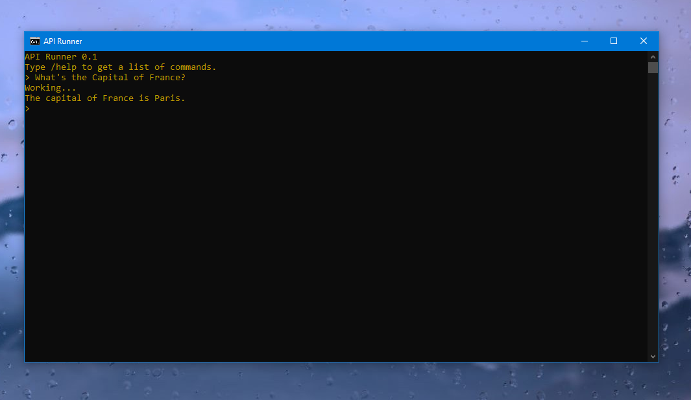

# API-Runner
API Runner lets you test/run APIs locally using OpenAI library. Originally designed for Unsloth.

# How to use
Skip those steps if you already have OpenAI and OS libraries installed!

Execute those in your terminal:

1. Clone the repository.
```
git clone https://github.com/ScratchTheCuriousCat/API-Runner/
```
Install the requirements (use python or python -m if not installing)

2. Install OpenAI
```python
pip install openai
```
3. Install OS
```python
pip install os
```

# Running
Execute those in your terminal:
1. Access folder
```
cd API-Runner
```
2. Execute file
```
python app.py
```
Now, press 1 to change the model, Base URL and API.
And now it should be ready!

Note: If not working, execute powershell command before running.
